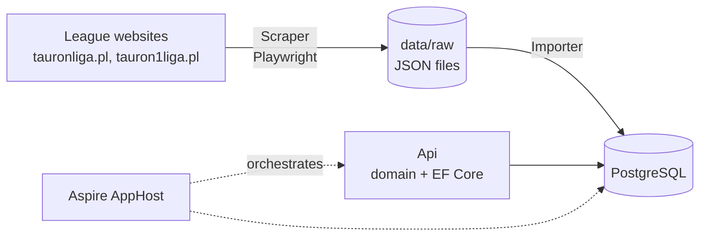

# 🏐 Fantasy Volleyball League

A volleyball data platform and, later, a fantasy game in the style of Fantasy Premier League: users build squads
of real players and score points from their real match statistics.

The current focus is the data: matches, results, player statistics, upcoming fixtures and historical seasons of
the Polish men's leagues (TAURON Liga, formerly PlusLiga, from 2000/01 and TAURON 1. Liga from 2018/19).

## ✨ Target features

### 📊 Volleyball data
- Matches, set scores and full player statistics, including historical seasons
- Upcoming fixtures
- Players tracked across seasons and clubs
- Rosters per season

### 🎮 Fantasy league
- Create your own volleyball fantasy team from real players
- Score points based on players' real match performance
- Leaderboards, transfers and lineups

## 🏗️ Architecture



Scraped data is stored as self-describing JSON files first. They are the source of truth: the database can be
rebuilt from them at any time without scraping the websites again.

| Project | Role |
|---|---|
| [`src/FantasyVolleyballLeague.Scraper`](src/FantasyVolleyballLeague.Scraper/README.md) | CLI that scrapes league websites into `data/raw`. |
| [`src/FantasyVolleyballLeague.Importer`](src/FantasyVolleyballLeague.Importer/README.md) | Console app that loads `data/raw` into PostgreSQL (idempotent). |
| `src/FantasyVolleyballLeague.VolleyballData` | Volleyball data model: domain, EF Core `DbContext` and migrations. |
| `src/FantasyVolleyballLeague.DataApi` | Public read-only ASP.NET Core minimal API (vertical slices, versioned). |
| `FantasyVolleyballLeague.AppHost` | .NET Aspire: PostgreSQL container, DataApi, and the Scraper and Importer as resources started on demand. |
| `FantasyVolleyballLeague.ServiceDefaults` | Shared Aspire defaults (OpenTelemetry, health checks). |
| `src/FantasyVolleyballLeague.Contracts` | Constants shared by the AppHost, the apps and the integration tests (database name, pinned Postgres image). |
| `tests/` | Scraper parser tests (offline, on saved HTML pages), Importer tests and architecture tests. |

## 🚀 Getting started

Prerequisites: [.NET 10 SDK](https://dotnet.microsoft.com/download) and
[Docker Desktop](https://www.docker.com/products/docker-desktop/).

```powershell
# 1. Start PostgreSQL and the Api (applies the database migrations); keep it running
dotnet run --project FantasyVolleyballLeague.AppHost

# 2. Install the Playwright browser used by the Scraper (once per Playwright version)
dotnet build src/FantasyVolleyballLeague.Scraper
pwsh src/FantasyVolleyballLeague.Scraper/bin/Debug/net10.0/playwright.ps1 install chromium

# 3. Scrape data: rosters first, then matches (the full history takes a few hours)
dotnet run --project src/FantasyVolleyballLeague.Scraper -- --job Rosters --from 2018
dotnet run --project src/FantasyVolleyballLeague.Scraper -- --job Matches

# 4. Import into the database (or start the "importer" resource in the Aspire dashboard)
dotnet run --project src/FantasyVolleyballLeague.Importer
```

For a quick try, scrape only the current season: `--job Matches --current true`. To keep the data fresh, start
`scraper-matches`, `scraper-rosters` and `importer` from the Aspire dashboard. See the
[Scraper](src/FantasyVolleyballLeague.Scraper/README.md) and
[Importer](src/FantasyVolleyballLeague.Importer/README.md) documentation for all options.

## 🧪 Tests

```powershell
dotnet test
```

## 📐 Conventions

Architecture and code style rules live in [`.claude/rules/architecture.md`](.claude/rules/architecture.md), and
the project context in [`.claude/rules/project-overview.md`](.claude/rules/project-overview.md). Package versions
are managed centrally in `Directory.Packages.props`; analyzer warnings are build errors.
