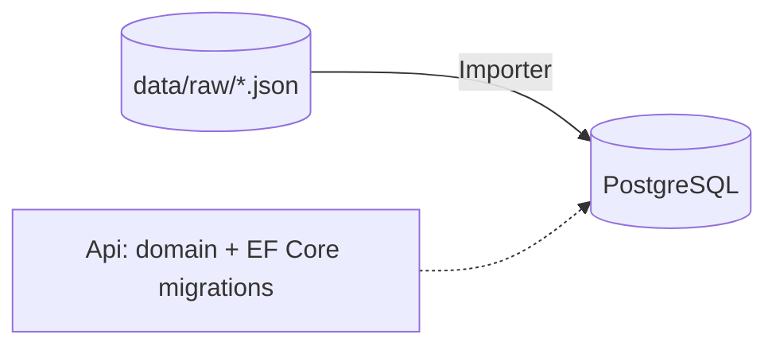
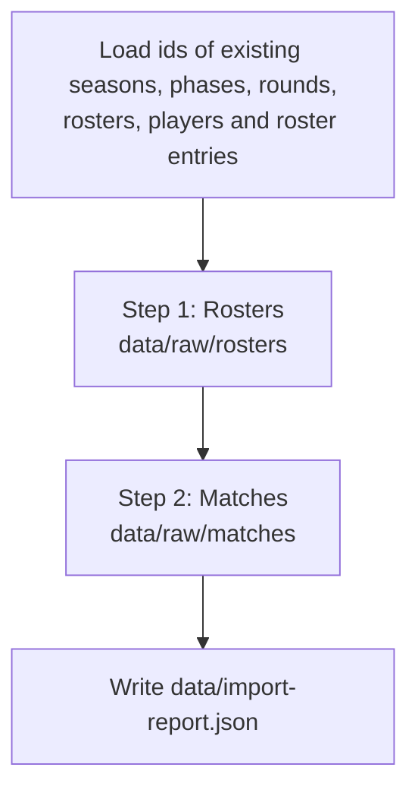

# FantasyVolleyballLeague.Importer

Console application that loads the raw JSON files written by the
[Scraper](../FantasyVolleyballLeague.Scraper/README.md) (`data/raw`) into PostgreSQL, using the EF Core
`FantasyVolleyballLeagueDbContext` and domain model of `FantasyVolleyballLeague.VolleyballData`.



The import is **idempotent**: running it again with the same files changes nothing, and running it after a new
scrape only updates what changed. Because every row can be rebuilt from `data/raw`, the database can be dropped
and re-imported at any time (e.g. after a domain model change).

## Quick start

Prerequisites: .NET 10 SDK, Docker Desktop (PostgreSQL runs in a container started by the Aspire AppHost) and the
database schema applied (see [Database schema](#database-schema)).

**From the Aspire dashboard:** start the AppHost, then start the `importer` resource. Aspire passes the
connection string, and the importer waits until the Api is healthy (migrations applied).

**From the command line:** create `src/FantasyVolleyballLeague.Importer/appsettings.local.json` (gitignored):

```json
{
  "ConnectionStrings": {
    "FantasyVolleyballLeagueDb": "Host=localhost;Port=5432;Database=FantasyVolleyballLeagueDb;Username=postgres;Password=<password>"
  }
}
```

The password is generated by Aspire for the Postgres container and stored in the AppHost user secrets under
`Parameters:fantasy-volleyball-league-postgres-password`
(`dotnet user-secrets list --project FantasyVolleyballLeague.AppHost`). Then:

```powershell
dotnet run --project src/FantasyVolleyballLeague.Importer
```

A connection string from environment variables (as set by Aspire) takes precedence over `appsettings.local.json`.

## Configuration

`appsettings.json`:

```json
{
  "Storage": { "DataRoot": "data" },
  "Importer": {
    "Leagues": [
      { "Key": "PlusLiga", "Name": "TAURON Liga", "Country": "Poland", "Gender": "Men", "DivisionNumber": 1 },
      { "Key": "PLS1Liga", "Name": "TAURON 1. Liga", "Country": "Poland", "Gender": "Men", "DivisionNumber": 2 },
      { "Key": "TauronLigaKobiet", "Name": "TAURON Liga Kobiet", "Country": "Poland", "Gender": "Women", "DivisionNumber": 1 },
      { "Key": "Tauron1LigaKobiet", "Name": "TAURON 1. Liga Kobiet", "Country": "Poland", "Gender": "Women", "DivisionNumber": 2 }
    ]
  }
}
```

| Setting | Meaning |
|---|---|
| `Storage:DataRoot` | Same data folder as the Scraper. A relative path is resolved against the directory containing `FantasyVolleyballLeague.sln`. |
| `Importer:Leagues:Key` | League key used by the Scraper in folder names (`data/raw/*/{Key}/`). |
| `Importer:Leagues:Name` | Current display name. A league is identified by **country, gender and division**, not by its name, so a sponsor rename only updates `League.Name`. |
| `Country`, `Gender` | Must match an entry of the `LeagueCountry` and `LeagueGender` lookups in the Api domain (`Poland`; `Men`, `Women`). An unknown value stops the import with an error. |
| `DivisionNumber` | 1 for the top division, 2 for the second, ... |

Only leagues listed here are imported.

## How it works

The import runs a sequence of **steps** (`Steps/`, `IImportStep`) ordered by `Order`, then writes a report.



Rosters run first, so that the match step can match widget-era players (statistics without player ids) to the
season roster.

### Step 1: rosters

For every roster file:

1. **Season** and **roster** (a club in a season) are found or created. A roster is matched by the club id
   (`ExternalId`) first, then by name within the season.
2. **Players** are matched by their website id. New players are created; existing ones get their profile updated
   (full name, date of birth, height, weight, attack reach).
3. **Roster entries** (`RosterPlayer`: shirt number, position, `MemberFrom`/`MemberTo`) are created or updated. The dates
   come from the `Career` of the player (the stint in this club). A player who moved during the season is also given
   an entry, with the dates of the stint, in the roster of each other club from his career (a roster lists only the
   end of the season). Files scraped before the career was read have no dates; the entries then have no dates.

### Step 2: matches

Matches are upserted by **(league, website match id)**:

| Situation | Result |
|---|---|
| Match not in the database | Inserted with its sets, player statistics and MVP. |
| File's `ScrapedAtUtc` is newer than `Match.SourceScrapedAt` | Updated: schedule (round, rosters, date), status, details, sets, statistics and MVP are replaced. This is how a scheduled match becomes finished. |
| File not newer | Skipped. |

Season, phase and round are taken from the file content, not from folder names. Changes are saved in batches of
100 matches.

### Player resolution

Each statistics line is matched to a player within the roster of its team:

1. **Player id** from the file (archive and table-era seasons).
2. **Shirt number** in the roster, confirmed by a shared name token (widget era).
3. **Name** in the roster.
   Members who belonged to the club on the match date (`MemberFrom`/`MemberTo`, one day of tolerance because the
   website's dates are not exact) are tried first, so a shirt number worn by two players one after the other is
   unambiguous.
4. The only player of that **name on any roster of the same gender and season**, in any division. This finds a
   player who moved during the season (the roster of his former club does not list him) and clubs of another
   division (e.g. a play-off opponent).
5. Otherwise an **unresolved player** without a website id is created (or reused when the same name was already
   unresolved) and listed in the report.

Names are compared as a set of upper-case tokens without diacritics, so `Benjamin Toniutti` (roster) equals
`Toniutti Benjamin` (widget statistics). A player found in the statistics but missing from the roster is added to
it. The MVP is matched by player id, otherwise by name among the match participants.

## Report

Every run writes `data/import-report.json` and prints a summary:

```
Rosters: 30; matches inserted: 751, updated: 0, skipped: 0; players by roster: 1415, unresolved players: 0, matches without MVP: 0, file errors: 0
```

| Field | Meaning |
|---|---|
| `RostersImported`, `MatchesInserted`, `MatchesUpdated`, `MatchesSkipped` | What was imported in this run. |
| `PlayersResolvedByRoster` | Statistics lines matched through a roster (no player id in the file). |
| `PlayersResolvedBySeason` | Lines matched by name on another roster of the same gender and season (step 4 above). |
| `RosterEntriesFromCareer` | Roster entries created from the career of a player who moved during the season. |
| `UnresolvedPlayers` | Players that could not be matched. Usually means the roster of that season was not scraped. |
| `UnresolvedMvps` | MVPs given by name that are not among the match participants. |
| `FileErrors` | Files that could not be read (invalid JSON, unsupported `SchemaVersion`, unknown status) or duplicate lines. Such files are skipped; the rest of the import continues. |
| `Warnings` | Wrong data on the website that the import repaired, e.g. one player id used for both squads of a match (two players merged into one profile): the second line is imported as a separate player without a website id. |

## Database schema

The Importer does not create or migrate the schema. The DataApi applies the EF Core migrations on startup in
Development (so starting the AppHost is enough), or apply them directly:

```powershell
dotnet ef database update --project src/FantasyVolleyballLeague.VolleyballData --startup-project src/FantasyVolleyballLeague.DataApi --connection "<connection string>"
```

### Rebuilding the database from scratch

```powershell
# 1. Drop the database (data can be recreated from data/raw)
docker exec fantasy-volleyball-league-postgres sh -c 'PGPASSWORD="$POSTGRES_PASSWORD" psql -U postgres -h localhost -d postgres -c "DROP DATABASE \"FantasyVolleyballLeagueDb\" WITH (FORCE);"'
# 2. Recreate the schema
dotnet ef database update --project src/FantasyVolleyballLeague.VolleyballData --startup-project src/FantasyVolleyballLeague.DataApi --connection "<connection string>"
# 3. Import everything
dotnet run --project src/FantasyVolleyballLeague.Importer
```

## Tests

`tests/FantasyVolleyballLeague.Importer.Tests` covers name matching (`PlayerNameKey`) and value parsing
(percentages, UTC offsets):

```powershell
dotnet test tests/FantasyVolleyballLeague.Importer.Tests
```