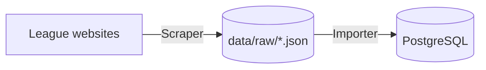
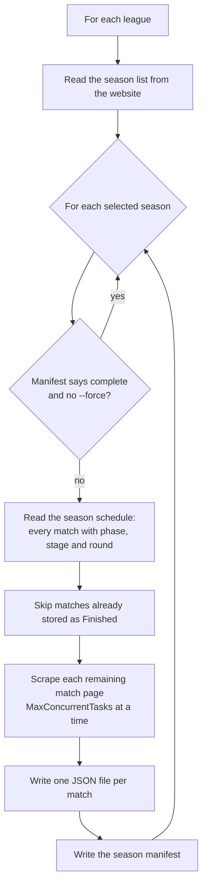

# FantasyVolleyballLeague.Scraper

Command-line tool that collects volleyball data from league websites with
[Playwright](https://playwright.dev/dotnet/) and HtmlAgilityPack and stores it
as raw JSON files in `data/raw`. It does not touch the database: the
[Importer](../FantasyVolleyballLeague.Importer/README.md) loads the files into
PostgreSQL.



The raw JSON layer is the source of truth: when the domain model or the import
logic changes, the database is rebuilt from these files without scraping again.

## Quick start

Prerequisites: .NET 10 SDK and the Playwright browser.

```powershell
dotnet build src/FantasyVolleyballLeague.Scraper
# Once per Playwright version: downloads Chromium
pwsh src/FantasyVolleyballLeague.Scraper/bin/Debug/net10.0/playwright.ps1 install chromium

# Refresh the current season of every configured league
dotnet run --project src/FantasyVolleyballLeague.Scraper -- --job Matches --current true
```

The Aspire AppHost also exposes two resources that run the current-season
refresh on demand from the dashboard: `scraper-matches`
(`--job Matches --current true`) and `scraper-rosters`
(`--job Rosters --current true`).

## Command-line options

| Option      | Values                         | Meaning                                                                                    |
| ----------- | ------------------------------ | ------------------------------------------------------------------------------------------ |
| `--job`     | `Matches` (default), `Rosters` | What to scrape: match files or season rosters.                                             |
| `--league`  | league key, e.g. `PlusLiga`    | Only this league. All configured leagues when omitted.                                     |
| `--from`    | start year, e.g. `2000`        | First season to process (inclusive).                                                       |
| `--to`      | start year, e.g. `2018`        | Last season to process (inclusive).                                                        |
| `--current` | `true`                         | Only the newest season listed on the website. Overrides `--from`/`--to`.                   |
| `--force`   | `true`                         | Scrape again what is already stored: complete seasons, finished matches, existing rosters. |

Boolean options take an explicit value (`--current true`). A season is
identified by its start year, so `--from 2015 --to 2015` means 2015/16.

Examples:

```powershell
# Full history of TAURON Liga (formerly PlusLiga), 2000/01 onwards
dotnet run --project src/FantasyVolleyballLeague.Scraper -- --job Matches --league PlusLiga --from 2000

# Rosters of both leagues since 2018/19 (needed to resolve players of the widget era, see below)
dotnet run --project src/FantasyVolleyballLeague.Scraper -- --job Rosters --from 2018

# Re-scrape one season after a parser fix
dotnet run --project src/FantasyVolleyballLeague.Scraper -- --job Matches --league PlusLiga --from 2004 --to 2004 --force true
```

Runs can be interrupted (Ctrl+C) and started again: already stored data is
skipped, so a run resumes where the previous one stopped.

## Configuration

`appsettings.json` (copied next to the binary):

```json
{
  "Playwright": { "Headless": true, "MaxConcurrentTasks": 3 },
  "Storage": { "DataRoot": "data" },
  "Leagues": [
    {
      "Key": "PlusLiga",
      "Source": "Pls",
      "DisplayName": "TAURON Liga",
      "BaseUrl": "https://www.tauronliga.pl"
    },
    {
      "Key": "PLS1Liga",
      "Source": "Pls",
      "DisplayName": "TAURON 1. Liga",
      "BaseUrl": "https://www.tauron1liga.pl"
    }
  ]
}
```

| Setting                         | Meaning                                                                                                                                                                                          |
| ------------------------------- | ------------------------------------------------------------------------------------------------------------------------------------------------------------------------------------------------ |
| `Playwright:Headless`           | `false` shows the browser, useful when debugging a parser.                                                                                                                                       |
| `Playwright:MaxConcurrentTasks` | Matches (or roster players) scraped in parallel. Keep it low to be polite to the websites.                                                                                                       |
| `Storage:DataRoot`              | Root of the data folder. A relative path is resolved against the directory containing `FantasyVolleyballLeague.sln`, so the Scraper and the Importer share `<repo>/data` wherever they run from. |
| `Leagues:Key`                   | Stable league identifier used in folder names. It does not change when the sponsor brand does.                                                                                                   |
| `Leagues:Source`                | Which [source](#sources) scrapes the league. An unknown value stops the Scraper at startup.                                                                                                      |
| `Leagues:BaseUrl`               | Website of the league.                                                                                                                                                                           |

Any setting can be overridden on the command line, e.g.
`--Playwright:Headless false`.

## How it works

### Matches (`--job Matches`)



- **Scheduled matches** are stored too (date, teams, venue), so the data
  includes upcoming fixtures. They are scraped again on every run until they are
  played.
- **Failed matches** (e.g. a page timeout) are listed in the manifest's
  `FailedMatchIds`. They have no file, so the next run retries them.
- **A season is complete** only when it is not the newest season, every match is
  finished and nothing failed. Complete seasons are skipped unless `--force` is
  set.
- Files are written to a temporary file first and then renamed, so an
  interrupted run never leaves a half-written JSON file.

### Rosters (`--job Rosters`)

For each selected season the Scraper reads the clubs of the season, each club's
squad page and every player's profile page (date of birth, height, weight,
attack reach). Rosters of past seasons are skipped when the file already exists;
the newest season is always refreshed, because squads change during the season.
A failing profile page keeps the data from the squad page.

## Output: `data/raw`

```
data/raw/
├── matches/{LeagueKey}/{YYYY-YYYY}/{matchId}.json
├── matches/{LeagueKey}/{YYYY-YYYY}/_manifest.json
└── rosters/{LeagueKey}/{YYYY-YYYY}/{clubId}.json
```

Files are self-describing (`SchemaVersion: 1`): a match file carries its league,
season, phase, stage and round, so the Importer never relies on folder names.
Identifiers (`MatchId`, `ExternalId`) are the ids used by the league website.

<details>
<summary>Match file (shortened)</summary>

```json
{
  "SchemaVersion": 1,
  "ScrapedAtUtc": "2026-10-23T16:27:12.1234567Z",
  "League": "PlusLiga",
  "Season": { "StartYear": 2026, "EndYear": 2027, "ExternalId": 53 },
  "Phase": { "Name": "Regular Season", "Order": 1 },
  "Stage": { "Name": "", "Order": 1 },
  "Round": { "Name": "Kolejka 1", "Order": 1 },
  "MatchId": 1104808,
  "Status": "Finished",
  "StatisticsLevel": "Full",
  "Date": "2026-10-16T15:30:00Z",
  "IsTimeConfirmed": true,
  "MatchNumber": "001",
  "Attendance": 2873,
  "Mvp": { "Name": "Aleksa Batak", "ExternalId": 3169 },
  "FirstReferee": "Maciej Kolendowski",
  "SecondReferee": "Paweł Burkiewicz",
  "Commissioner": "Janusz Kapka",
  "VenueName": "Arena Katowice",
  "VenueCity": "Katowice",
  "Sets": [
    { "HomePoints": 26, "AwayPoints": 24 },
    { "HomePoints": 25, "AwayPoints": 23 }
  ],
  "HomeRoster": {
    "Name": "GKS Katowice",
    "ExternalId": 18,
    "SetsWon": 3,
    "Players": [
      {
        "Number": 1,
        "Name": "Krulicki Bartłomiej",
        "ExternalId": null,
        "PointsTotal": 6,
        "Aces": 0,
        "...": "..."
      }
    ]
  },
  "AwayRoster": { "...": "..." }
}
```

</details>

| Field                     | Notes                                                                                                           |
| ------------------------- | --------------------------------------------------------------------------------------------------------------- |
| `Status`                  | `Scheduled` or `Finished`.                                                                                      |
| `StatisticsLevel`         | `Full`, `LineupOnly` (archive seasons list players without statistics) or `None` (scheduled matches).           |
| `Date`, `IsTimeConfirmed` | UTC. For fixtures whose time is not announced yet, the date is local midnight and `IsTimeConfirmed` is `false`. |
| `Stage`                   | Playoff stage, e.g. `I Ćwierćfinał`; empty when a phase has a single stage (the regular season).                |
| Player statistics         | `null` when the source does not provide them. Percentages are kept as written by the website (`"41%"`, `"-"`).  |

A roster file contains `Club` (`ExternalId`, `Name`) and `Players`
(`ExternalId`, `FullName` as "First Last", `Position`, `ShirtNumber`,
`DateOfBirth`, `Height`, `Weight`, `AttackReach`). The manifest stores the
scrape time, `IsComplete`, match counts and `FailedMatchIds`.

## Sources

A **source** is the website system the data comes from, recognised by its HTML
structure and URL patterns. One source can serve several leagues. The processors
in `DataProcessors/` do not know any website: for each league they ask the
source selected by `Leagues:Source`.

```
Sources/
├── ILeagueSource.cs           contract of a source
├── LeagueSourceResolver.cs    picks a league's source from all registered sources
└── Poland/Pls/                Polish leagues run by PLS
    ├── PlsLeagueSource.cs
    ├── PlsUrls.cs, PlsExternalIds.cs
    ├── Seasons/               season list
    ├── Matches/               schedule, match header and the statistics parsers
    └── Rosters/               clubs, squad and player pages
```

### PLS (Poland)

PLS is Polska Liga Siatkówki S.A., the company running the Polish professional
leagues (TAURON Liga, TAURON Liga Kobiet, TAURON 1. Liga, TAURON 1. Liga
Kobiet). All their websites run on the same CMS, so one set of parsers serves
every league, and match, club and player ids are shared between the sites. The
domains were rebranded for 2026/27 (`plusliga.pl` → `tauronliga.pl`,
`pls1liga.pl` → `tauron1liga.pl`).

The match page header (result, sets, teams, date, officials, MVP) looks the same
for every season, but player statistics come in three formats:

| Seasons         | Format                                                  | Player ids | Statistics  |
| --------------- | ------------------------------------------------------- | ---------- | ----------- |
| 2000/01–2007/08 | archive tables                                          | yes        | lineup only |
| 2008/09–2018/19 | `table.table-colored`                                   | yes        | full        |
| 2019/20 onwards | volleystation widgets (iframes rendered in the browser) | **no**     | full        |

Widget-era statistics have no player ids, so the Importer matches those players
through the season roster by shirt number and name. Scrape rosters for those
seasons (`--job Rosters --from 2018`).

### Adding a source

1. Create `Sources/{Country}/{Provider}/` with a class implementing
   `ILeagueSource`. Return a unique `Key` and map the website to the shared
   models in `Models/` (`MatchRecord`, `RosterRecord`, `ScheduleEntry`, ...).
2. Register it in `Program.cs`:
   `builder.Services.AddScoped<ILeagueSource, MyLeagueSource>();`.
3. Add the league to `Leagues` with `"Source": "<Key>"`, and to the Importer
   configuration.
4. Add parser tests with saved HTML pages (see below).

Nothing else changes: the processors, the storage and the JSON format are
source-independent.

## Tests

`tests/FantasyVolleyballLeague.Scraper.Tests` runs the parsers against real
pages saved in `Fixtures/` (one per format, plus season, team and player pages),
so they run offline:

```powershell
dotnet test tests/FantasyVolleyballLeague.Scraper.Tests
```

When a website changes, save the new page into `Fixtures/`, add a test and fix
the parser.
